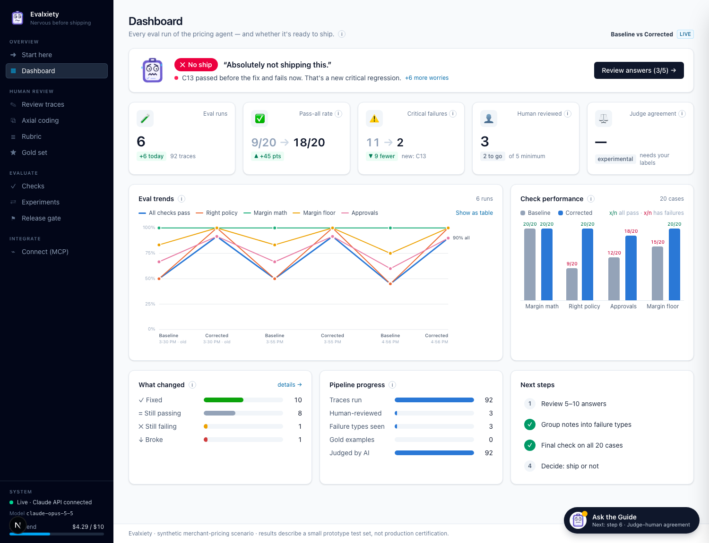
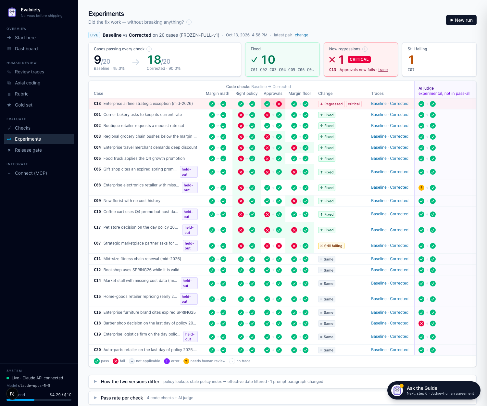
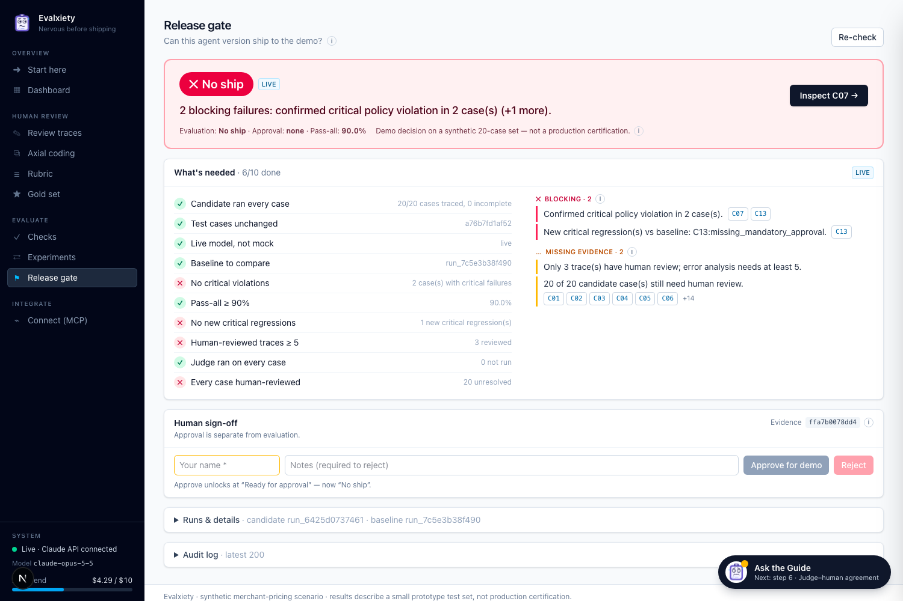
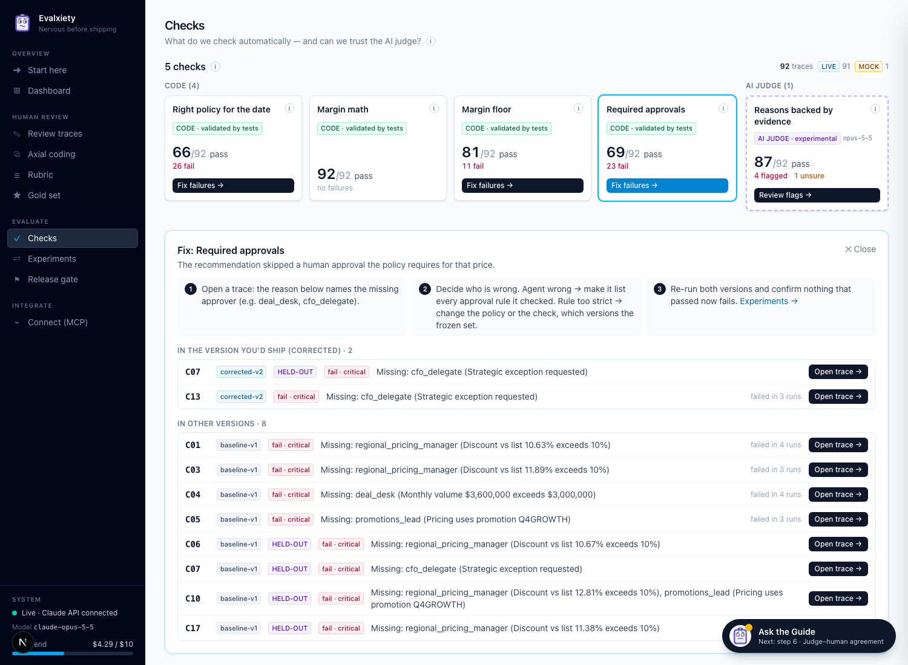

# Evalxiety

**Because your AI should be nervous before shipping.**

Evalxiety tests an AI agent before you ship it. It runs the agent on test cases, has a human review the answers,
checks the evidence, and refuses to say "ship it" until the evidence holds up.

I built it in one day for a Claude hackathon. The agent under test is a Claude-powered **merchant pricing agent** working
on synthetic business data. Want it running in 30 seconds? Skip to [Run it](#run-it).



## The result it caught

I built two versions of the pricing agent and ran both on the same 20 locked test cases with Claude Opus 5.5:

| | Baseline | Corrected |
|---|---|---|
| Cases passing every check | 9 / 20 | **18 / 20** |
| Picked the policy in force on the decision date | 9 / 20 | **20 / 20** |
| Kept margin above the policy floor | 15 / 20 | **20 / 20** |
| Routed every required human approval | 12 / 20 | 18 / 20 |

*The pass counts use only the four code checks. The AI judge is excluded because it has only 3 human labels to be
checked against.*

The fix worked: 10 cases fixed and 1 regressed (net +9). Four of the fixed cases were held out, so the agent was never
tuned on them. Four cases is an anecdote, not proof that the fix generalises.

**Evalxiety still says No ship.** 18 / 20 looks like a win. But one case that passed before the fix (C13) now skips a
required CFO sign-off, and another (C07) misses the same sign-off in both versions. A 90 % average hides exactly those
two.





## How it works

Evalxiety follows the eval method from Hamel Husain and Shreya Shankar:

1. **Run the agent** on realistic cases and save every trace (inputs, evidence, answer, cost, latency).
2. **Review answers as a human.** You fill in a 5-question checklist. Automated results stay hidden until you've saved
   your answers, so they don't anchor your judgement.
3. **Define what "good" means.** Group your review notes into failure types, and keep a versioned rubric.
4. **Check automatically.** Code checks cover objective rules. One narrow AI judge covers the subjective question: is
   every reason backed by the evidence? The judge is labelled *experimental* and is reported separately from the code
   checks. Its agreement with human labels is measured as TPR / TNR with Wilson intervals. Until each class has at
   least 30 labels, those numbers are reported as "insufficient".
5. **Compare and ship.** Run versions on the same locked test cases (any edit to a case or policy changes a pinned hash)
   and read fixes and regressions case by case. Then decide at a release gate: *No ship · Not enough evidence ·
   Ready for approval · Approved for demo*.



## Highlights

- **Read-only MCP server.** Ask Claude Desktop or Claude Code "Is the agent ready to ship?" or "Why did C13 regress?".
- **Fix panel.** Click a check to see every failing answer, why it failed, and how to fix that kind of failure.
- **One-screen trace review.** A compact summary and the checklist, then "you vs automated checks".
- **Experimental AI judge with explicit uncertainty.** Undefined metrics stay "undefined", never 0 % or 100 %.
  Inconclusive or errored verdicts are counted separately and never treated as PASS. You can choose Claude Haiku, Sonnet
  or Opus as the judge model, and each one is calibrated separately.
- **Credit controls.** Mock mode by default, cached responses (re-runs are free), a spend cap, and confirmation before
  paid batches. Held-out cases stay locked until an audited, irreversible reveal.

## Run it

```bash
npm install
cp .env.example .env.local    # MOCK_MODE=true: no API key or spend needed
npm run dev -- -p 3123        # http://localhost:3123
npm test                      # Vitest suite
```

This repo includes the data from my live run, so the dashboard, experiments and release gate show real results
immediately. For live Claude calls, set `MOCK_MODE=false` and `ANTHROPIC_API_KEY` in `.env.local`.
`LIVE_SPEND_CAP_USD` caps spend.

To connect Claude Code over MCP (read-only, no spend), keep the app running on port 3123, or point `AGENTTRUST_URL`
at another port. Then:

```bash
claude mcp add evalxiety -- node /absolute/path/to/mcp/server.mjs
```

The project was called AgentTrust during the hackathon. That name survives in the package name, the `AGENTTRUST_URL`
variable and some internal docs.

## Built with

Next.js 16 (App Router) · TypeScript · Tailwind CSS · Anthropic SDK (Claude Opus 5.5) · Zod · Vitest · Model Context
Protocol SDK · local JSON storage. Built with Claude Code.

## Limitations

- **20 synthetic cases is a rehearsal, not production.** The cases and policies are synthetic and were written by
  the same person who built the agent (with Claude Code). The numbers show the method working; they can't establish
  production reliability.
- **The AI judge is uncalibrated.** It has 3 human labels against a 30-per-class minimum, so treat its verdicts as
  unvalidated.
- **Only the built-in pricing agent is supported today.** Next steps are trace import, an HTTP adapter for your own
  agent, and a CI gate command.

## Credits

Methodology: Hamel Husain and Shreya Shankar's writing on product-specific evals ([evals FAQ](https://hamel.dev/blog/posts/evals-faq/),
[LLM-as-a-judge](https://hamel.dev/llm-judge/)).
